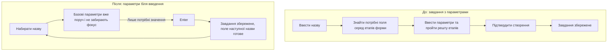
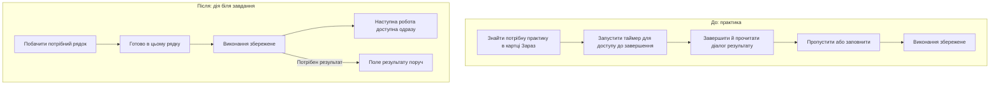
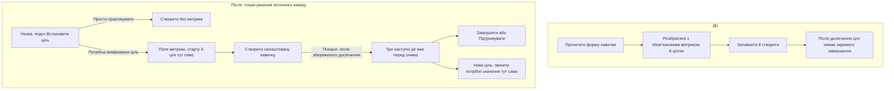
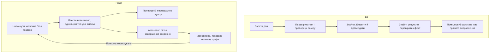
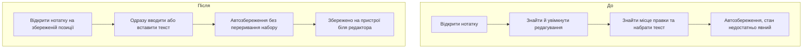
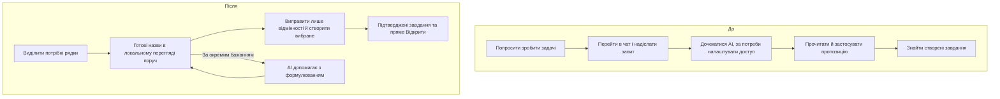
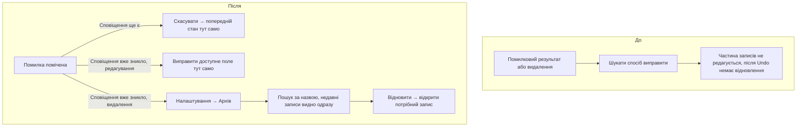
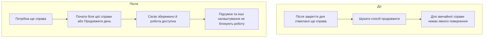

# Karkas: швидше до результату — схеми до й після

Головний критерій — **час від початку наміру до коректного збереженого результату**, а не кількість блоків, екранів чи натискань. Більше видимих елементів або одне додаткове зрозуміле натискання можуть бути кращими, якщо людині не доводиться шукати, згадувати чи повторювати введення.

Це уточнена концепція, за якою після погодження внесено зміни у застосунок: [стан впровадження](<D:/Creation Soft/Karkas/output/implementation-2026-10-23.md>). Після окремого дозволу користувача пройшли 1070 автоматичних тестів і живі перевірки основних сценаріїв; [звіт випуску](<D:/Creation Soft/Karkas/output/release-2026-10-23/REPORT.md>). Порівняльні часові заміри не проводилися. Приклад «10 → 5 секунд» пояснює бажаний ефект; це не виміряний результат і не норматив для всіх сценаріїв.

Основа «До»: [карта чинного застосунку](<D:/Creation Soft/Karkas/output/user-journey-map-2026-10-23.md>) і [попередні живі перевірки](<D:/Creation Soft/Karkas/output/live-qa-2026-10-22/REPORT.md>). Основа «Після»: погоджені користувачем безперервне введення, автоматична панель параметрів, автозбереження, вибір дії після досягнення цілі та Архів у налаштуваннях. Довідка Refero Design: [форми, фокус і продуктивність](<C:/Users/Ivan/.codex/plugins/cache/openai-curated-remote/app-6a72258e6f18819183e5c4d8a56b78d9/1.0.2/skills/refero-design/references/craft-details.md>). Детальні правила цілісності даних зберігаються в [попередній специфікації](<D:/Creation Soft/Karkas/output/journey-redesign-before-after-2026-10-23.md>).

## Що скорочуємо

Час проходження охоплює пошук потрібного елемента, розуміння й вибір, введення, переміщення між елементами, обов'язкове очікування та виправлення помилок. Якщо процеси йдуть паралельно, їхній час не додаємо двічі.

У схемах нижче названо джерела затримок. Довжина стрілок не означає секунди. «Після» — гіпотеза прискорення; підпис «Збережено» завжди означає підтверджений локальний запис. Попередній показ результату і хмарна синхронізація вимірюються окремо.

## 1. Завдання: менше пошуку й перемикань під час введення

**Механізм прискорення:** не читати проміжні екрани, не шукати кнопку продовження, не повертатися мишею до назви після кожного завдання. Панель не пересуває поле, Enter і Tab працюють передбачувано. Часті значення дати можна обрати прямо в панелі; довільна дата лишається в календарі. Категорія береться з видимого контексту, дата й інші разові параметри не успадковуються непомітно.

Назва + Enter вже існує в поточному застосунку. Для завдання без параметрів не заявляємо прискорення лише через перемальовування схеми. Можливий виграш тут треба шукати у фокусі, відгуку введення та серійному створенні.

Під час редагування існуючого завдання параметр зберігається після вибору, текст — при виході з поля. Наступне поле можна змінювати, поки запис попереднього завершується; не потрібно стояти й чекати toast. При помилці введення лишається.

**Міряти:** від наданого завдання створити запис до його підтвердженого збереження. Окремі сценарії: тільки назва; назва + дата + категорія; серія з п'яти назв. Для серії також час від першого введення до збереження останнього запису, без дублів. Довжина назв у порівнянні однакова.

## 2. Виконання: не шукати завершення й не запускати зайву сесію

**Механізм прискорення:** «Готово» та таймер на передбачуваному місці в рядку, незалежно від стану картки «Зараз». Додатковий результат і анімація успіху не блокують наступну дію. Рядок не стрибає під курсором під час натискання; після завершення зберігається орієнтир у списку.

Для контрольної практики число все одно треба ввести: швидкість до «виконано» й швидкість до «замір збережено» — різні результати. Не можна оголосити весь сценарій швидшим, просто прибравши потрібний людині замір із підрахунку.

**Міряти:** від наміру завершити задану видиму практику до збереженого виконання; окремо — знайти її у списку та завершити; окремо — виконання разом із фактичним заміром. Реальний час тренування сюди не входить.

## 3. Навичка: не змушувати розбиратися з усіма налаштуваннями до початку

**Механізм прискорення:** зменшити час читання й роздумів над непотрібними параметрами. Для вимірюваної навички метрика та одиниця видимі разом, помилка пояснюється біля значення до виходу з форми. Стартове число не вигадується заради швидкого заповнення.

Після досягнення цілі не треба шукати налаштування: вибір показується автоматично, один раз на ціль. Вікно можна закрити. «Нова ціль» використовує явно показані поточну метрику й останній коректний замір; людина вводить справжню нову ціль, а не повторно налаштовує все з нуля. Якщо три кнопки сповільнять продовження практики, їх показ у картці без перехоплення фокусу треба буде порівняти з вікном.

**Міряти окремо:** створення навички для практики; створення вимірюваної навички з наперед заданими даними; вибір стану після досягнення цілі. Дні чи тижні розвитку навички не є часом роботи з формою. Різні наміри не порівнюються як один і той самий сценарій.

## 4. Результат: замінити число там, де його видно

**Механізм прискорення:** починати редагування без пошуку окремої форми; поточне число можна замінити без ручного стирання кожної цифри. Тип «Практика / Контрольний замір» визначений початковим наміром і видимий, тому не треба згадувати прихований прапорець. Числова клавіатура й формат відповідають значенню.

Автозбереження не дорівнює «почекати таймер перед наступною дією». Вихід із поля завершує введення, запис іде без блокування наступної роботи. До підтвердження видно стан збереження, а не удаваний успіх. Попередній графік не видається за збережений результат.

**Міряти:** від показу заданого результату до збереженого нового значення з правильним типом; окремо — виправлення помилкового числа. Також час до першого відгуку та до підтвердження запису: це різні показники.

## 5. Блокнот: не втрачати час між думкою й набором

**Механізм прискорення:** відновити місце читання/правки, дозволити набір відразу, не вимагати назви до запису думки. Для нової нотатки фокус у тексті після явної дії створення; для існуючої — не стирати виділення й не переносити курсор несподівано. Назва може братися з першого рядка. Вставлення та звичайні клавіші не блокуються.

Автозбереження вже існує. Його прискорення не можна заявити як нову можливість; гіпотеза стосується готовності редактора, пошуку місця та ясного підтвердження. Показ стану не змушує чекати припинення набору й не вимагає перевірочного перезавантаження.

**Міряти:** від відкриття заданої нотатки до коректно збереженої правки в заданому місці; окремо — від створення нотатки до збереження заданої думки. Для обох версій однакова довжина тексту й місце правки. Час першого символу — допоміжний, а не кінцевий результат.

## 6. Нотатка → завдання: не переносити текст вручну й не чекати AI

**Механізм прискорення:** використовувати вже написаний текст, обирати спільну категорію/дату для вибраних рядків, не повторювати це для кожного завдання. Перегляд поруч із джерелом скорочує повторне перечитування та переходи. AI не входить у обов'язкове очікування. Вже додані пункти позначені, невдалий пункт повторюється без повторного введення всього списку.

**Міряти:** від готового однакового виділення до всіх коректно збережених вибраних завдань, включаючи потрібні людині перевірки й виправлення назв. Додатково — сценарій від пошуку потрібного фрагмента нотатки. Не порівнювати швидкість створення неякісних рядків із правильно сформульованими завданнями.

## 7. Помилки: скоротити час повернення до роботи

**Механізм прискорення:** Undo біля підтвердження, доступні поля після таймауту, Архів із пошуком та недавніми записами, повернення одразу до відновленого об'єкта. Не змушувати відновити, потім самостійно шукати запис у вкладках. Пошук в Архіві — нова вимога концепції, а не опис уже наявної можливості.

Вікно Undo триває 8 секунд, але людина **не чекає його завершення**. Після видалення можна продовжувати роботу, а запис фоново переходить в Архів. Очікування не губиться після закриття програми. Точне скасування й звичайна повторна зміна статусу лишаються різними діями; дата, час і статистика не псуються заради швидкого візуального ефекту.

**Міряти:** від виявлення заданої помилки до коректного відновленого стану й готовності продовжувати роботу. Окремі випробування: Undo, ручна правка після таймауту, відновлення через Архів. Якщо маршрут «До» взагалі відсутній, його результат — «відновлення недоступне», а не вигадана кількість секунд.

## 8. Продовження дня й допоміжні налаштування: зберегти контекст

**Механізм прискорення:** запуск потрібного завдання з його рядка зберігає контекст, без повернення на початок маршруту. Меню категорії має видиму точку входу, перейменування не вимагає створення нової категорії й ручного перенесення. Вихід із налаштувань повертає попередню вкладку, фільтр, прокрутку й фокус.

Локальна робота не чекає входу в акаунт, AI, хмари чи завершення декоративної анімації. Помилка сервера — окреме питання доступності, а не затримка, яку можна прибрати схемою. Остаточне очищення й зовнішнє надсилання не стають мовчазними заради швидкості.

**Міряти:** від наміру продовжити закритий день до збереженого запуску заданого завдання; окремо — зміна категорії й повернення до попередньої роботи. Недоступний нині маршрут позначати як недоступний, не як дуже повільний.

## Як визначити, чи стало швидше

| Що порівнювати | Як не спотворити результат |
| --- | --- |
| Повний час сценарію в секундах | Початок до пошуку кнопки; кінець після коректного локального запису, а не після кліку |
| Медіана та повільні проходження | Не показувати лише найшвидший успіх; окремо перший і повторний досвід |
| Частка успіху та помилки | Виправлення, повтори й невдалі спроби теж враховуються |
| Час відгуку інтерфейсу | Візуальний відгук не підміняє надійне збереження |
| Час пошуку, введення й очікування | Видно, яку затримку прибрало конкретне рішення |
| Однакові дані й умови | Та сама довжина тексту, складність параметрів, пристрій і вихідний екран |

Для порівняння потрібні еквівалентні набори завдань і чергування порядку версій, щоб повторне знайомство з одним і тим самим текстом не видати за покращення дизайну. Робота на реальних даних користувача не потрібна.

**Критерій прийняття:** скорочення фактичного часу до правильного результату без погіршення успішності, збереження даних та доступності. Якщо виміряна база певного сценарію буде 10 секунд, а узгоджена ціль — 5, оцінюємо саме ці секунди. Якщо назва сама набирається довше п'яти секунд, інтерфейс не може гарантувати такий час для довільного тексту: треба прибирати зайве введення, підтримувати вставлення й порівнювати однаковий обсяг роботи.

Поки для всіх сценаріїв: **час «До» — не виміряно; час «Після» — не виміряно**. Після окремого дозволу на перевірки таблицю можна заповнити реальними значеннями; поточна робота — схеми й вимоги до прискорення.
